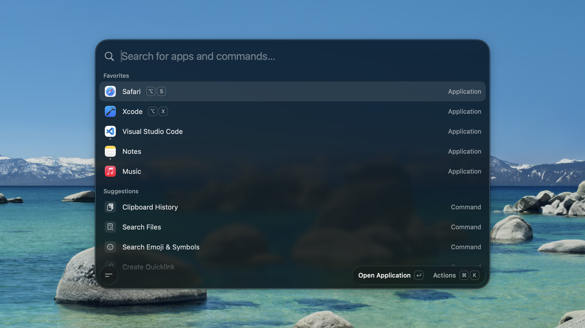

# Blitz

**A fast, fully native macOS launcher that stays out of your way.**

  
  
  

Press one shortcut and a palette floats in over whatever you're doing: launch apps, search files,
paste from your clipboard history, do math, manage windows, check your next meeting or ask an AI —
then it's gone again. Blitz lives in the menu bar, has no Dock icon and holds itself to **under
100 MB of RAM**.

It is built with SwiftUI and AppKit for the current macOS only, with **one third-party dependency**
(SwiftTerm, for the built-in terminal), no Electron and no telemetry. Every feature beyond the
launcher and clipboard is off until you turn it on. And it **runs the Raycast extensions you already
use**, rendered as native SwiftUI.

  

## Features

### Launch and find

- **App launcher** — fuzzy-search and launch anything, pin favorites, see what's running, quit one
  app or all of them.
- **Hotkeys** — one global shortcut summons the palette; bind any app, command, quicklink or
  extension to a shortcut of its own, and an app's key toggles it between focused and hidden.
- **Search Files** — open files and folders from the folders you choose, through Spotlight, with no
  index of Blitz's own.
- **Search Screenshots** — find a capture by name, or by the text inside it if you opt in.
- **Contacts** — search your address book to call, email, edit or open a card, and mark the people
  you reach most so they show up in the launcher's own search.
- **Dictionary** — define a word from the Mac's own dictionaries, or whatever you just typed.
- **Switch Windows and Search Menu Bar Items** — raise any open window, or press any menu item of
  the front app, by name.

### Everyday tools

- **Clipboard history** — text and images, searchable, pinnable, pasted back into the app you were
  using or as plain text.
- **Calculator** — math, units, time, data rates, and live currency and crypto conversions inline;
  ⌘↵ puts the answer back in the search bar.
- **Notes** — an unlimited collection of plain Markdown files in one floating editor, rendered as
  you write and searchable from the palette.
- **Snippets** — reusable Markdown templates with placeholders, arguments, nested references and
  optional keyword expansion.
- **Quicklinks** — turn a URL, search, file or deeplink into a command, with placeholders for typed
  input, the selection, the clipboard or the date.
- **Emoji picker** — a searchable emoji grid, one keystroke away.
- **Camera and QR codes** — a live, mirrored preview to check yourself before a call, a photo to the
  clipboard, or a QR code read and opened.

### Calendar and reminders

- **Meetings** — your next meeting on the empty palette and in the menu bar, one key to join it, or
  let it join itself.
- **Reminders** — every open reminder in the palette to edit, complete or delete, and Smart Reminder:
  type `Greg wants tomorrow a cake` and get `Give Greg a cake`, due tomorrow.

### Windows

- **Window management** — 35 Rectangle-style actions: halves, quarters, thirds, sizing, nudging,
  display moves, fullscreen and Spaces, plus custom sizes of your own.
- **Layouts and rooms** — save an arrangement of apps and restore it in one press, or walk into a
  room: its windows tiled on your display, everything else stepped back.

### Automation

- **Custom commands** — run shell scripts in any interpreter their `#!` line names, with arguments,
  aliases and global hotkeys, in the background or in a terminal of Blitz's own.
- **Apple Shortcuts** — search and run the shortcuts you built in the Shortcuts app.
- **System actions** — lock, sleep, restart, empty the trash, toggle appearance, Bluetooth, output
  and microphone mute, hidden files and more.
- **Uninstall** — remove an app together with the caches, preferences and containers it leaves
  behind.

### AI

- **Quick AI and AI Agent** — ask from the palette, or keep longer conversations in their own window
  with a searchable, pinnable history. Use Apple Intelligence, your own API key, or an AI CLI you
  already have installed — Claude, Codex, Grok, OpenCode or Cursor.
- **Tools** — let chat read your calendar and reminders, or change them after you confirm, and
  connect remote or local MCP servers whose tools it asks before using.
- **Quick Actions** — fix grammar, rewrite, translate or summarize the selected text in any app.

AI is off out of the box, and every part of it is a separate opt-in.

### Raycast extensions

- **Run them natively** — search the Raycast Store, build one from GitHub, or import what you already
  have installed in Raycast. Commands, forms, lists, grids, menu bar commands and background
  refreshes run in JavaScriptCore and render as SwiftUI — no Node, no browser.

### Make it yours

- **Backup and import** — export your settings to a file, keep them as an editable
  `~/.config/blitz/settings.json`, or import your setup from Raycast.
- **Updates** — Blitz updates itself from GitHub Releases, or only when you ask.
- **Welcome Tour** — a short first-launch walkthrough, there again whenever you want it.

## Install

Download the latest `Blitz-Universal-<version>.zip` from
[Releases](https://github.com/fa-krug/blitz/releases/latest), unzip it and move `Blitz.app` to
`/Applications`. Releases are signed with Developer ID and notarized, so it opens like any other
downloaded app.

From then on Blitz updates itself from the same releases, with no further steps.

## Permissions

Blitz asks for each permission the first time you use a feature that needs it, never on launch.

**Accessibility** — needed when Blitz pastes or expands text into another app, manages windows, or
presses a menu item. Grant it in **System Settings → Privacy & Security → Accessibility**. Snippets
ship disabled, and keystrokes are matched locally, never stored and never sent anywhere.

Calendar, Reminders, Contacts, the camera and screen recording are each requested only by the
feature that reads them.

## Using it

1. The Welcome Tour opens on first launch: record the shortcut that summons Blitz, or take ⌘Space
   from Spotlight. It lives in **Settings → General** afterwards.
2. Press it anywhere → the palette floats in. Type to filter, **↵** to launch, **⌘K** for a row's
   actions.
3. **Tab** rings the launcher, Quick AI and Clipboard History — from the launcher it hands what you
   typed to Quick AI, or to the clipboard when AI is off; **↑/↓** move, **Esc** dismisses.
4. Open a row's page in **Settings → Applications**, **Commands** or any other launcher pane and
   record a global shortcut for it.
5. Turn on the rest in **Settings** — each feature has its own pane and its own switch.

## Building from source

See **[docs/development.md](docs/development.md)** for the toolchain and build, and
**[docs/release.md](docs/release.md)** for how a push to `main` becomes an update.
**[docs/](docs/README.md)** indexes everything else — architecture, engineering standards, the
design system and one document per feature.

## Contributing

Read **[CONTRIBUTING.md](CONTRIBUTING.md)** first — it covers the memory budget every PR is held to
and the before/after video requirement for visual changes. Every PR fills in the
**[pull request template](.github/PULL_REQUEST_TEMPLATE.md)**. Security issues go through
[SECURITY.md](SECURITY.md), not the issue tracker.

## Acknowledgements

Blitz began as a fork of [Tinycast](https://github.com/abue-ammar/tinycast). Thank you to
[Abue Ammar](https://github.com/abue-ammar) for building it and releasing it as open source — it
gave Blitz its start.

## License

[AGPL-3.0](LICENSE)
